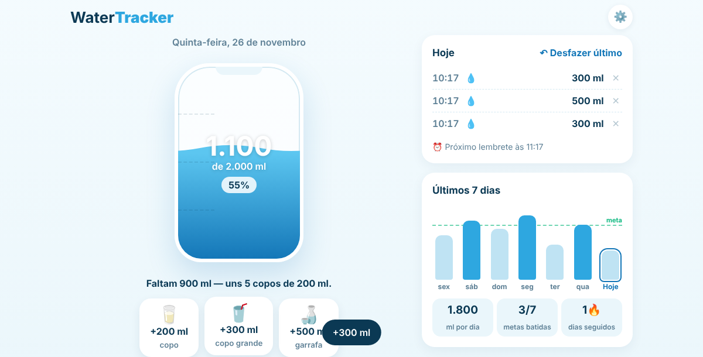

# WaterTracker — Consumo de água

Registre a água que você bebe ao longo do dia, acompanhe a meta diária e receba lembretes visuais para se hidratar.

🔗 **[Ver o site no ar](https://iamviniciuslima05.github.io/PROJETO-WaterTracker/)**



## Funcionalidades

- **Garrafa animada** que enche conforme você bebe
- Botões rápidos de **copo, copo grande e garrafa**
- **Meta diária** com sugestão pelo peso
- **Lembretes visuais** no intervalo e horário que você escolher
- Notificação do navegador (opcional)
- Registros do dia com **desfazer**
- **Gráfico dos últimos 7 dias** e dias seguidos batendo a meta

## Tecnologias

HTML5 · CSS3 · JavaScript · Notification API · localStorage

## Estrutura

```
index.html
css/style.css
js/script.js
```

## Como rodar

Não precisa instalar nada: baixe o projeto e abra o `index.html` no navegador, ou acesse a versão publicada acima.

---
Feito por **Vinicius Lima** · [Portfólio](https://viniciuslimadev.netlify.app) · [LinkedIn](https://www.linkedin.com/in/viniciuslima25/)
